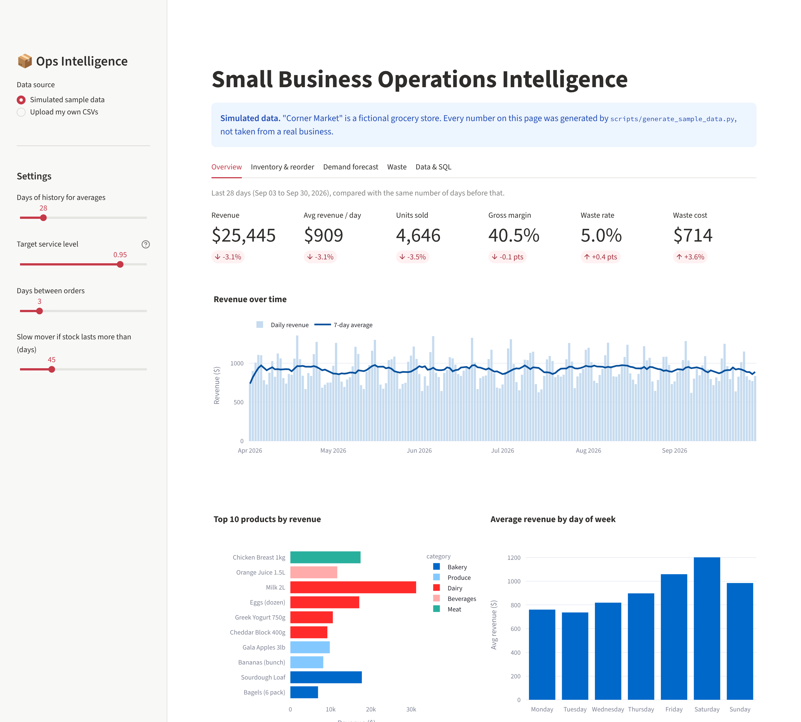
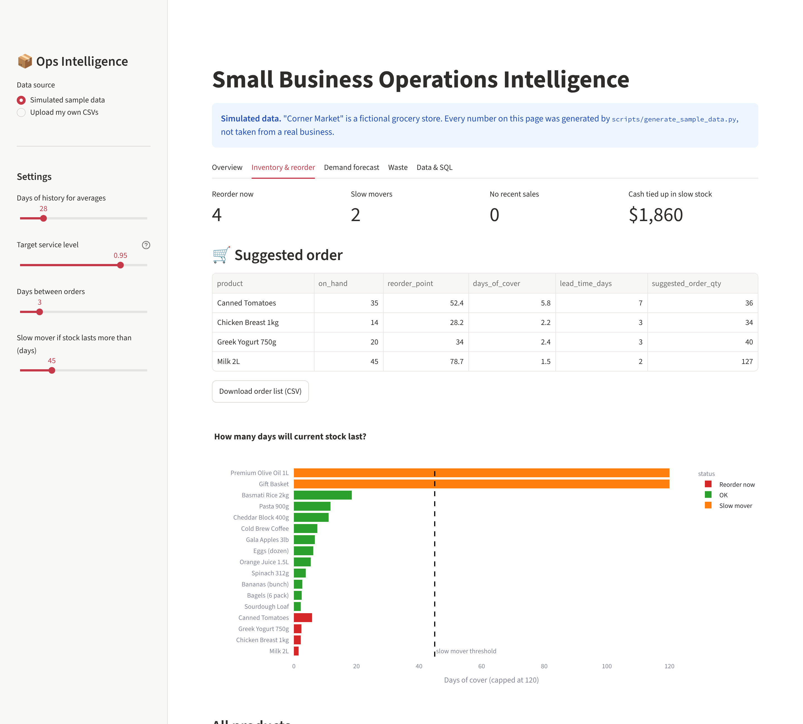
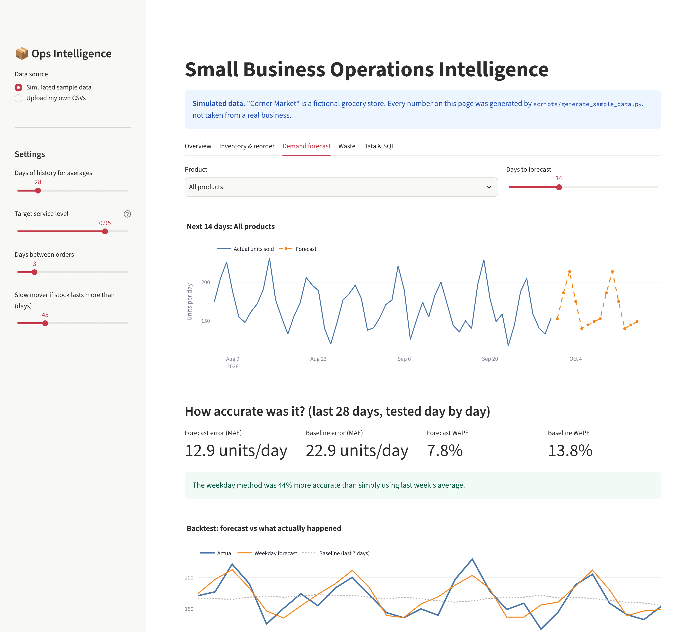
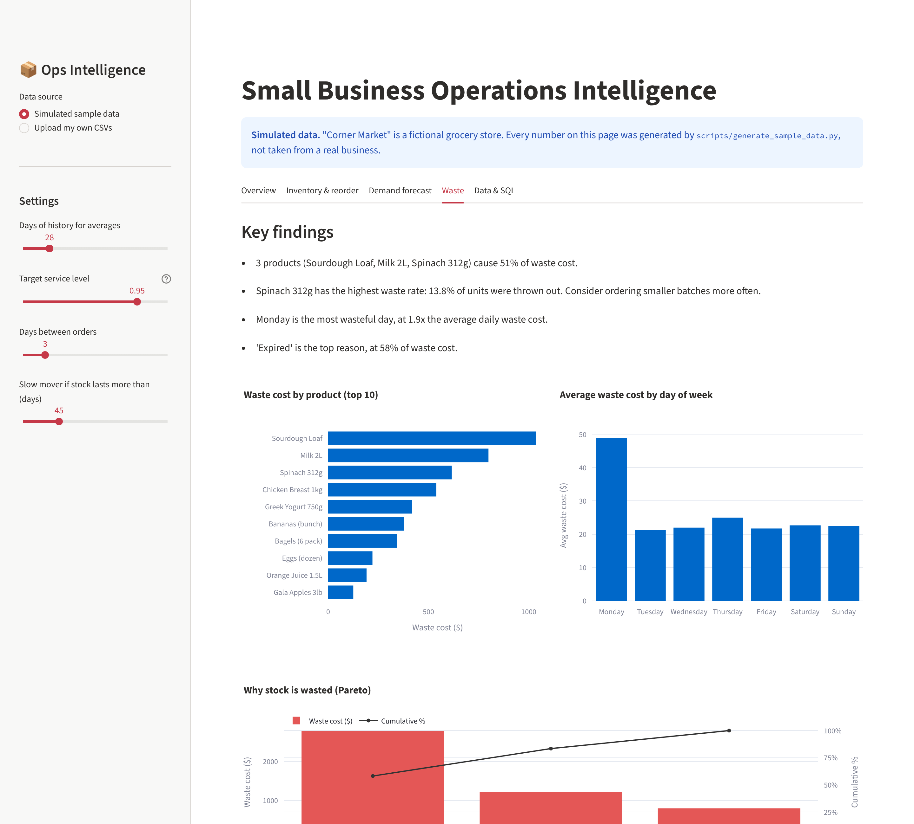
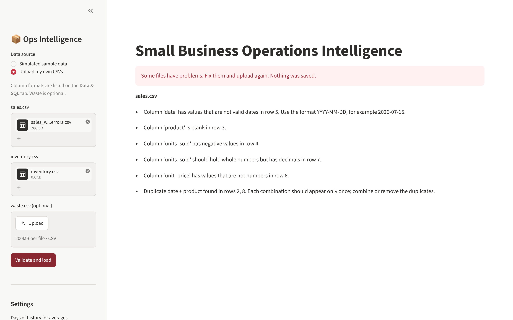

# Small Business Operations Intelligence

A Streamlit dashboard that turns a small business's everyday spreadsheets (sales, inventory and waste) into answers an owner can act on:

- **What should I reorder today, and how much?**
- **Which products are tying up cash on the shelf?**
- **How much will I sell next week?** (and how much can I trust that number)
- **Where is my waste coming from, and what is it costing me?**

Built with Python, pandas, SQLite, Streamlit and Plotly. Every calculation is a plain formula that is written out in the app, the code and this README, so it can be checked by hand.

> **All sample data is simulated.** "Corner Market" is a fictional grocery store. Its numbers are generated by [`scripts/generate_sample_data.py`](scripts/generate_sample_data.py) with patterns built in on purpose (busy weekends, perishable waste, a few items running low). Nothing in this repo comes from a real business.



## Why I built this

Independent shops, cafés and food programs usually run on spreadsheets and gut feel. They know their sales, but not which items will run out before the next delivery, or which ones quietly cost them money in waste. Larger retailers solve this with expensive planning software. This project asks how far a few clear, explainable formulas can go with data a small business already has.

It grew out of my earlier [meal program analytics](https://github.com/AffanAmeer/meal-program-analytics) project, where planning production against demand and reducing waste were the core problems.

## Features

| Feature | What it does |
|---|---|
| **CSV upload and validation** | Checks every file before it is used: missing columns, blank cells, bad dates, text in number columns, negative or fractional quantities, duplicate rows. Errors name the exact spreadsheet row. Nothing is saved until every file passes. |
| **KPI overview** | Revenue, average daily revenue, units sold, gross margin, waste rate and waste cost for the last N days, compared with the N days before. Revenue trend, top products, and revenue by weekday. |
| **Inventory and reorder** | Reorder point, safety stock, days of cover and a suggested order quantity for every product, with a downloadable order list. Flags slow movers and the cash tied up in them. All settings (history window, service level, days between orders, slow-mover threshold) are adjustable in the sidebar. |
| **Demand forecast** | Same-weekday average forecast for any product or the whole store, plus a day-by-day backtest against a simple baseline so you can see whether the forecast is worth using. |
| **Waste insights** | Waste cost and waste rate by product, waste by day of week, and a Pareto chart of waste reasons, with plain-English findings generated from the data. |
| **SQLite storage and SQL explorer** | Validated data is stored in a local SQLite database (`ops.db`). The Data & SQL tab lets you run your own read-only `SELECT` queries against it. |

### What it finds in the simulated data

These are the results the app produces on the bundled sample data (last 28 days, default settings):

- **4 products need reordering now** (Milk 2L, Greek Yogurt, Chicken Breast, Canned Tomatoes). Milk has 1.5 days of cover against a 2-day lead time.
- **2 slow movers** (Premium Olive Oil, Gift Basket) hold **$1,860** of stock that would take over 100 days to sell.
- The **weekday forecast** for total store volume is off by **12.9 units/day (7.8% WAPE)**, compared with **22.9 units/day (13.8%)** for a last-7-days average: a 44% smaller error.
- **3 products cause 51% of waste cost**, **Monday waste is 1.9× the daily average**, and **"Expired" accounts for 58%** of waste cost.

Because the data is simulated, these findings show the tool works; they are not claims about a real store.

## Screenshots

| Inventory and reorder | Demand forecast |
|---|---|
|  |  |

| Waste insights | Validation errors |
|---|---|
|  |  |

## Quick start

You need Python 3.10 or newer.

```bash
git clone https://github.com/AffanAmeer/smallbiz-ops-intelligence.git
cd smallbiz-ops-intelligence

python -m venv .venv
# macOS / Linux
source .venv/bin/activate
# Windows
.venv\Scripts\activate

pip install -r requirements.txt
streamlit run app.py
```

The app opens at http://localhost:8501 with the simulated data loaded. To try your own files, choose **Upload my own CSVs** in the sidebar. To see the validator catch mistakes, upload [`data/sample/sales_with_errors.csv`](data/sample/sales_with_errors.csv) as the sales file.

Run the tests:

```bash
pytest
```

Regenerate the sample data (the output is identical each time because the random seed is fixed):

```bash
python scripts/generate_sample_data.py
```

## Data format

Column names are not case sensitive, and spaces are treated as underscores (`Units Sold` works). Extra columns are ignored with a warning.

**sales.csv**: one row per product per day

| date | product | category | units_sold | unit_price |
|---|---|---|---|---|
| 2026-09-30 | Milk 2L | Dairy | 31 | 5.49 |

**inventory.csv**: one row per product, as of today

| product | category | on_hand | unit_cost | lead_time_days |
|---|---|---|---|---|
| Milk 2L | Dairy | 45 | 3.70 | 2 |

**waste.csv** (optional): one row per waste event

| date | product | units_wasted | reason |
|---|---|---|---|
| 2026-09-28 | Sourdough Loaf | 3 | Expired |

## How the numbers are calculated

**KPIs**
- Revenue = units sold × unit price
- Gross margin = (revenue − units sold × unit cost) ÷ revenue (products without a cost are left out)
- Waste rate = units wasted ÷ (units sold + units wasted)
- Waste cost = units wasted × unit cost
- Changes in margin and waste rate are shown in percentage points.

**Reorder logic** (using the last N days of sales, with zero-sale days counted as 0)
- Average daily demand = units sold ÷ N
- Safety stock = z × standard deviation of daily demand × √lead time, where z comes from the service level (95% → 1.645)
- Reorder point = average daily demand × lead time + safety stock
- Days of cover = on hand ÷ average daily demand
- Suggested order = average daily demand × (lead time + days between orders) + safety stock − on hand
- Status: **Reorder now** if on hand ≤ reorder point; **Slow mover** if days of cover exceed the threshold (45 by default); **No recent sales** if nothing sold in the window.

**Forecast**
- Forecast for a day = average units sold on the same weekday over the last 4 weeks.
- Baseline = average of the previous 7 days.
- Backtest: for each of the last 28 days, forecast that day using only earlier data, then compare with what happened.
- MAE = average size of the error in units. WAPE = total absolute error ÷ total actual units.

## Limitations

I would rather state these up front than have them discovered:

- **Simulated data.** The sample data has patterns I put there, so finding them proves the code works, not that the method works on a real business.
- **Sales are treated as demand.** If an item sold out, real demand was higher than recorded sales, so forecasts and reorder points will be too low for items that often run out.
- **The forecast is deliberately simple.** It ignores holidays, promotions, weather and trends, and reacts slowly to sudden changes. For some products (Sourdough Loaf in the sample) it does no better than the baseline, and the app says so.
- **Low-volume items have noisy percentages.** A product selling 0.1 units a day can show a 190% WAPE while being off by less than one unit. The app points this out.
- **The safety stock formula assumes** fairly steady, roughly normally distributed demand and reliable lead times.
- **Inventory is a single snapshot.** There is no stock history, so the app cannot detect past stock-outs or check stock-count accuracy.
- **Single user, local only.** No login, and every upload replaces the previous data in `ops.db`.

## Possible next steps

- Detect likely stock-out days (sales dropping to zero for a usually steady item) and exclude them from demand.
- Add holiday flags to the forecast and compare it with a library model such as exponential smoothing.
- Track inventory over time so the app can measure how often each item actually ran out.
- Deploy to Streamlit Community Cloud for a public demo link.

## Project structure

```
app.py                          Streamlit screens (no calculations here)
ops/
  schemas.py                    required columns and types for each CSV
  validation.py                 file checks and readable error messages
  database.py                   SQLite save, load and read-only queries
  kpis.py                       revenue, margin and waste KPIs
  inventory.py                  reorder points, safety stock, slow movers
  forecast.py                   weekday forecast and backtest
  waste.py                      waste breakdowns and findings
scripts/generate_sample_data.py builds the simulated dataset
data/sample/                    simulated CSVs (plus one deliberately broken file)
tests/                          pytest tests with small hand-checkable datasets
docs/                           screenshots, demo script, interview notes
```

## More

- [Demo script](docs/DEMO_SCRIPT.md): a 3-minute walkthrough
- [Interview talking points](docs/INTERVIEW_TALKING_POINTS.md)
